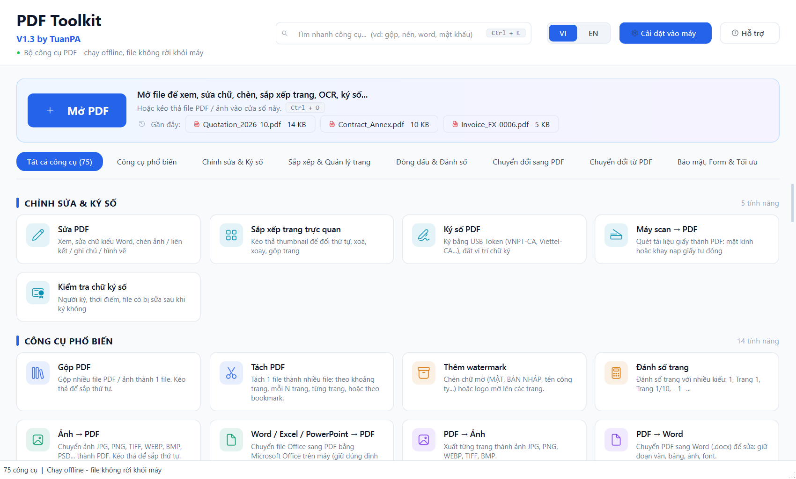
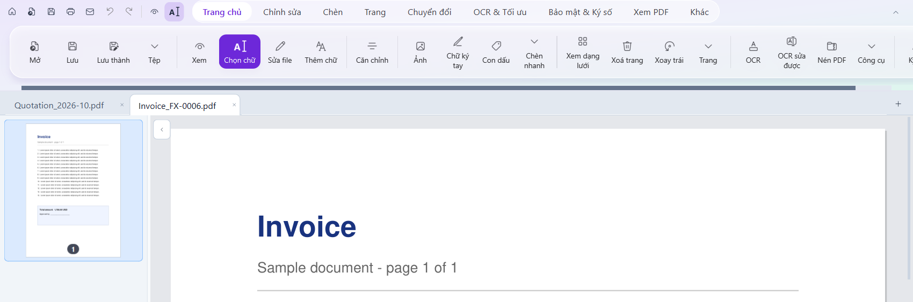
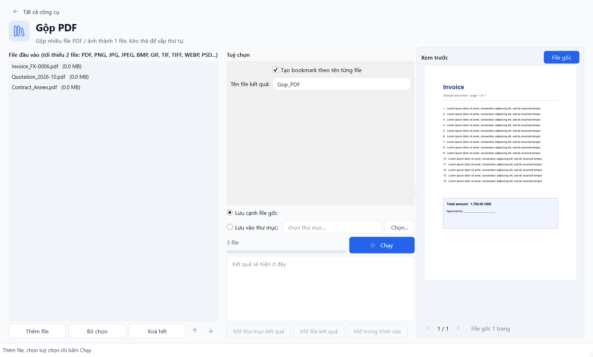
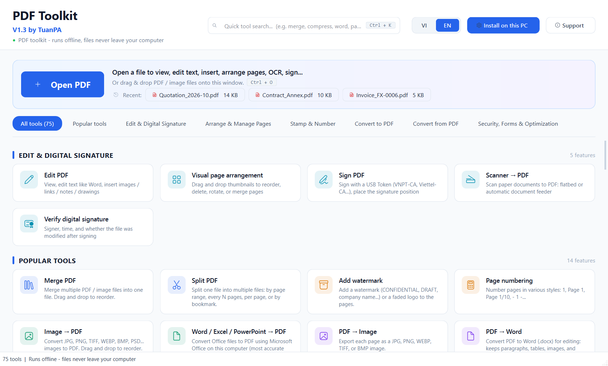
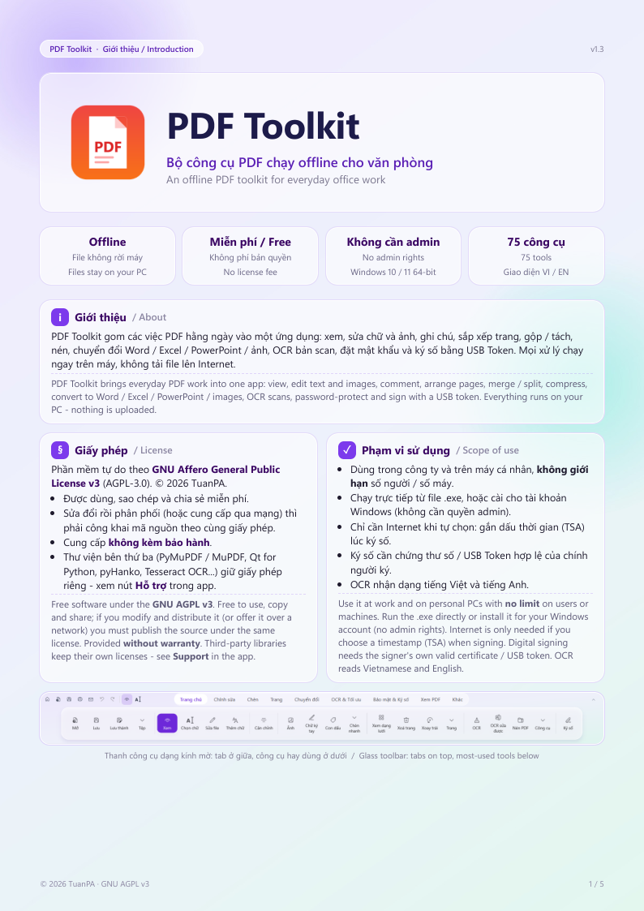
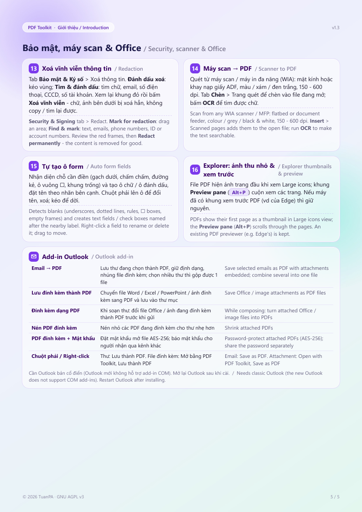

# PDF Toolkit

Bộ công cụ PDF chạy offline cho Windows 10 / 11: xem, sửa chữ và ảnh, ghi chú, sắp xếp trang, gộp / tách, nén, chuyển
đổi Word / Excel / PowerPoint / ảnh, OCR tiếng Việt, đặt mật khẩu, xoá vĩnh viễn thông tin, ký số bằng USB Token. Mọi xử
lý chạy ngay trên máy, file không bị tải lên Internet. Không cần quyền admin, giao diện tiếng Việt / English.

*An offline PDF toolkit for Windows 10 / 11: view, edit text and images, comment, organize pages, merge / split,
compress, convert to and from Office / images, Vietnamese & English OCR, passwords, redaction and digital signatures
with a USB token. Everything runs on your PC - nothing is uploaded. No admin rights needed; Vietnamese / English UI.*

**Tải về / Download:** mục [Releases](../../releases) → `PDF-Toolkit-<phiên bản>-win64.exe` (khoảng 125 MB, gồm dữ liệu
OCR). Chạy thẳng được, không bắt buộc cài. Tài liệu: [Giới thiệu](docs/PDF_Toolkit_Introduction.pdf) ·
[Hướng dẫn cài đặt](docs/PDF_Toolkit_User_Manual.pdf) · [Giấy phép & phạm vi sử dụng](docs/PDF_Toolkit_License_and_Usage.pdf)

## Ảnh chụp màn hình / Screenshots

**Màn hình chính**: 75 công cụ theo nhóm, tìm nhanh bằng Ctrl+K (gõ không dấu cũng được)



**Trình sửa PDF**: ribbon kiểu Word, mỗi file một tab, bảng trang thu nhỏ bên trái



**Màn hình công cụ** (ví dụ Gộp PDF): thêm file, chọn tuỳ chọn, xem trước kết quả



<details><summary>Giao diện tiếng Anh / English UI</summary>



</details>

**Giới thiệu** (trích [file PDF giới thiệu](docs/PDF_Toolkit_Introduction.pdf))

<p> </p>

**Mã nguồn**: Python (PySide6 + PyMuPDF) và C# (add-in Office / Outlook, phần mở rộng Explorer). Xem mục
[Mã nguồn và build](#mã-nguồn-và-build) ở cuối trang.

## Phát cho người dùng

Gửi file exe tải từ Releases, hoặc **`dist\PDF Toolkit.exe`** nếu tự build. Chạy thẳng được, không bắt buộc cài.

### Cài vào máy và add-in Office (không cần quyền admin)

Ở trang chủ, bấm nút **Cài đặt vào máy** rồi chọn **Cài đặt / cập nhật vào máy...**. Chương trình được cài cho riêng tài khoản Windows đang đăng nhập, nên user thường tự cài được:

- Cài vào `%LOCALAPPDATA%\Programs\PDF Toolkit` ở dạng thư mục (`PDF Toolkit.exe` cùng thư mục `_internal`). Chỉ ghi registry trong `HKCU`, không cần UAC.
- **Bản đã cài mở trong khoảng 3 giây.** Bản 1 file chạy trực tiếp chậm hơn (10–50 giây tuỳ máy), vì mỗi lần mở phải giải nén khoảng 200 MB vào Temp và phần mềm bảo mật quét lại toàn bộ. Nên cài vào máy cho người dùng thường xuyên. Bước cài mất khoảng 1–2 phút.
- Bản đã cài tự đăng ký lại khi khởi động nếu thiếu thông tin trong registry hoặc vừa cập nhật phiên bản. Lệnh `--uninstall` chạy từ một bản exe khác sẽ không gỡ bản đã cài.
- Tạo shortcut trong Start Menu, và ngoài Desktop nếu chọn.
- Thêm PDF Toolkit vào **Open with** của file `.pdf`. Muốn đặt làm mặc định thì chọn trong Settings > Default apps (Windows không cho chương trình tự đặt).
- **Menu chuột phải "PDF Toolkit"** cho file `.pdf` (tên mục bằng tiếng Anh cho đồng bộ với Windows): Open, Merge selected files, Compress, Split, Rotate, Convert to Word / Excel / PowerPoint / images, OCR, Protect with / Remove password, Digitally sign. Windows 11 đặt menu này trong **Show more options** (hoặc Shift + chuột phải) - muốn hiện ngay ở menu đầu thì app phải đóng gói MSIX có chữ ký số, cần quyền admin. Chọn nhiều file: các file được gom về 1 cửa sổ. Bỏ bằng `--install --no-contextmenu`.
- **Ảnh thu nhỏ & xem trước trong Explorer** (`PDFToolkitShell.dll`): file PDF hiện ảnh trang đầu ở chế độ Large icons / Medium icons, và khung **Preview pane** (Alt + P) cuộn xem mọi trang. Trang PDF được vẽ bằng Windows.Data.Pdf có sẵn của Windows 10/11; Windows chạy phần này trong tiến trình riêng (dllhost / prevhost), không chạy trong Explorer. Khung xem trước chỉ được thêm khi máy chưa có. Microsoft Edge thường đã có sẵn khung xem trước PDF thì app giữ nguyên của Edge. Ảnh thu nhỏ cũ có thể còn trong cache của Windows, nên muốn thấy ngay thì chạy Disk Cleanup > Thumbnails. Gỡ cài đặt sẽ trả lại handler của app khác (PDF-XChange, Adobe...). Bỏ bằng `--install --no-explorer`.
- **Add-in Office** cho Word, Excel, PowerPoint: thêm tab **PDF Toolkit** trên ribbon. Mở lại Office sau khi cài để thấy tab.
  - *Tạo PDF*: **Tạo PDF**, **Tuỳ chọn**. Tuỳ chọn gồm: nơi lưu (cạnh file gốc / thư mục cố định / hỏi mỗi lần), phạm vi (cả tài liệu, trang hoặc slide hiện tại, vùng chọn, sheet đang mở), bookmark từ Heading, PDF/A, kèm nhận xét, tối ưu dung lượng, và việc làm sau khi tạo.
  - *Tạo & gửi email*: **Tạo và đính kèm email** mở thư Outlook có sẵn file PDF. **Trộn thư** (Word) tạo từ Mail Merge mỗi người một file PDF (đặt tên theo trường, ví dụ `{HoTen}`), có thể gửi email riêng cho từng người qua Outlook (mở thư nháp hoặc gửi ngay).
  - *Xem xét & nhận xét*: **Tạo và gửi để nhận xét** soạn sẵn email mời người khác ghi chú trên PDF. Menu **Nhận xét PDF** (Word) gồm: nhập nhận xét / tô sáng / gạch xoá từ file PDF đã duyệt vào Word dưới dạng Comment, tạo PDF kèm nhận xét & Track Changes, chấp nhận hoặc từ chối tất cả thay đổi, xoá tất cả nhận xét.
  - *Xử lý PDF*: PDF + Ký số / Mật khẩu / Nén / Watermark / Gộp file, mở thẳng công cụ tương ứng trong PDF Toolkit.
  - Gửi email cần Outlook bản cổ điển. Nếu không có, add-in mở thư mục chứa PDF để đính kèm thủ công.
- **Add-in Outlook** (bản cổ điển), thêm nhóm **PDF Toolkit**:
  - *Hộp thư / cửa sổ đọc thư*:
    - **Email → PDF** lưu thư đang chọn thành PDF: giữ định dạng thư qua Word, có dòng Từ / Gửi lúc / Đến / Tiêu đề, nhúng file đính kèm vào PDF. Chọn nhiều thư thì gộp được thành 1 file.
    - **Lưu đính kèm thành PDF** chuyển file Word / Excel / PowerPoint / ảnh đính kèm sang PDF và lưu vào thư mục; file PDF được chép nguyên.
  - *Chuột phải*:
    - Lên thư: **Lưu thành PDF (PDF Toolkit)**.
    - Lên file đính kèm: **Mở bằng PDF Toolkit** (file Office / ảnh được chuyển sang PDF trước), **Lưu thành PDF...**.
  - *Soạn thư*, cả cửa sổ soạn thư riêng và trả lời ngay trong khung đọc:
    - **Đính kèm dạng PDF** đổi file Word / Excel / PowerPoint / ảnh đang đính kèm thành PDF.
    - **Nén PDF đính kèm**: file đã gọn thì giữ nguyên.
    - **PDF đính kèm + Mật khẩu** đặt mật khẩu mở file AES-256. Mật khẩu được truyền qua biến môi trường, không lộ trên dòng lệnh. Hãy báo mật khẩu cho người nhận qua kênh khác.
  - Việc xử lý PDF chạy bằng `PDF Toolkit.exe --tool ...` (tiến trình ẩn) và hiện cửa sổ nhỏ "Đang xử lý...". Email → PDF cần Word; máy không có Word thì dàn trang thư HTML bằng PDF Toolkit. Outlook mới (New Outlook) không hỗ trợ add-in COM.
- Gỡ: chọn **Gỡ cài đặt...** trong cùng menu, hoặc vào Settings > Apps > PDF Toolkit. Gỡ cài đặt xoá **toàn bộ dữ liệu của app** trên máy: file gần đây, ngôn ngữ, tuỳ chọn công cụ, thư viện con dấu, cache font (registry `HKCU\Software\TuanPA\PDFToolkit`, `%APPDATA%\TuanPA\PDFToolkit`, `%LOCALAPPDATA%\PDFToolkit`). Cài lại sẽ như máy mới. File exe không chứa dữ liệu người dùng, nên cài sang máy khác cũng luôn bắt đầu trống.
- Cài lại bản mới đè lên để cập nhật. Phải đóng bản đã cài trước khi cập nhật.

IT cài hàng loạt (ví dụ qua script đăng nhập) bằng lệnh `"PDF Toolkit.exe" --install --quiet`. Các tuỳ chọn thêm: `--dir <thư mục>`, `--no-desktop`, `--no-startmenu`, `--no-openwith`, `--no-contextmenu`, `--no-explorer`, `--no-office`. Gỡ bằng `--uninstall --quiet`. Mã thoát 0 là thành công, 1 là lỗi.

## Giao diện (v1.3)

- **Trang chủ**: ô **Mở PDF** lớn ở trên cùng kèm danh sách file mở gần đây, bên dưới là lưới 75 công cụ có ô tìm kiếm (gõ không dấu cũng được). Nút **VI | EN** đổi ngôn ngữ giao diện. Màn hình công cụ có khung **xem trước** kết quả.
- **Trình sửa**: thanh **ribbon theo tab giống Word**: Trang chủ (công cụ hay dùng), Chỉnh sửa, Chèn, Trang, Chuyển đổi, OCR & Tối ưu, Bảo mật & Ký số, Xem. Góc trái có nút nhanh Trang chủ / Mở / Lưu / Hoàn tác / Làm lại.
- Công cụ trong ribbon chạy thẳng trên file đang mở. Công cụ biến đổi (watermark, số trang, OCR, nén, cắt lề...) áp dụng vào tài liệu và **hoàn tác được bằng Ctrl+Z**. Công cụ xuất file (PDF → Word/Excel/ảnh, tách file...) lưu kết quả cạnh file gốc.
- **Ghi chú**: rê chuột lên ghi chú để đọc, bấm để sửa / xoá.
- **Ô form** và **chữ ký tay** (vẽ bằng chuột hoặc dùng ảnh, lưu lại để dùng lần sau) trong tab Chèn.
- Công cụ mới v1.3: xoay góc tuỳ ý, làm thẳng bản scan, chỉnh sáng / tương phản, đổi màu chữ, chữ → nét vẽ, ghép 1 trang dài, sắp bản scan 2 mặt, nhãn trang, kích thước trang, sửa / xoá đính kèm, lớp nội dung (layers), dấu thời gian RFC 3161.
- **OCR** dùng Tesseract (mô hình tessdata_best tiếng Việt / Anh), tự xoay trang scan, tạo lớp chữ ẩn để tìm kiếm và copy.
- **Tab tài liệu như trình duyệt**: mở nhiều PDF cùng lúc, mỗi file 1 tab (thả nhiều file vào cửa sổ, Ctrl+O chọn nhiều file). Ctrl+Tab / Ctrl+Shift+Tab chuyển tab, Ctrl+W hoặc chuột giữa để đóng, kéo để đổi thứ tự, chuột phải: đóng tab khác / bên phải, mở thư mục, sao chép đường dẫn. Mỗi tab giữ trang, zoom và lịch sử hoàn tác riêng.
- **Chuyển đổi trong trình sửa**: các nút "Tạo PDF từ file khác" (Ảnh / Office / Text / Ebook / Email → PDF) không còn nhảy về màn hình nhập file: chọn file nguồn → chuyển đổi → **mở kết quả trong tab mới** hoặc **chèn vào sau trang đang xem**. "So sánh 2 file" dùng luôn file đang mở. Công cụ xuất ra PDF (tách file, trích trang...) có nút mở kết quả trong tab mới.
- **OCR → PDF chỉnh sửa được** (tab OCR & Tối ưu): nhận dạng bản scan rồi dựng lại trang bằng chữ thật (giữ vị trí, cỡ, màu, chữ đậm), xoá chữ cũ trên ảnh nền nhưng giữ logo / con dấu / chữ ký / kẻ bảng; xem trước 2 trang đầu cạnh bản gốc. Chữ nhận dạng sai sửa bằng chế độ Sửa file.
- **Kéo để di chuyển ảnh / chữ ký tay / con dấu** (chế độ Xem, Ảnh, Chữ ký tay, Con dấu): kéo để dời, kéo ô vuông góc dưới phải để đổi cỡ, chuột phải để xoá / nhân bản. Hoàn tác được.
- **Kéo để di chuyển / đổi cỡ khối vẽ đã chèn** (hình chữ nhật, elip, đường thẳng, mũi tên, hộp chữ, nét vẽ tay): ở chế độ Xem kéo cả khối; khi đang vẽ hình thì kéo ở viền khối (bấm bên trong vẫn vẽ được hình mới). Ô vuông góc dưới phải đổi cỡ tự do; chuột phải để xoá / xem ghi chú.
- **Căn chỉnh trên trang** (bấm chọn ảnh / chữ ký / con dấu / khối vẽ rồi bấm nút trong nhóm **Căn chỉnh** ở tab Trang chủ / Chỉnh sửa, hoặc chuột phải > **Căn chỉnh trên trang**): căn trái / giữa / phải, trên / giữa / dưới, hoặc chính giữa trang. Mặc định chừa lề 1 cm khi căn sát mép (bỏ tích trong cùng menu để căn sát mép trang). Đúng cả với trang xoay ngang. Hoàn tác được.
- **Con dấu (stamp)**: mẫu ĐÃ DUYỆT / APPROVED / BẢN SAO / MẬT... hoặc chữ tuỳ ý, thêm ngày giờ + người đóng, khung chữ nhật hoặc dấu tròn, đỏ / xanh / đen, nghiêng nhẹ.
- **Tách nền ảnh con dấu → chèn dạng tem** (tab "Từ ảnh con dấu"): chọn ảnh hoặc dán ảnh chụp màn hình (Ctrl+V). Chế độ tự động nhận màu mực con dấu (đỏ / xanh / tím) và chỉ giữ màu đó, bỏ chữ đen, chữ ký, kẻ bảng, nền giấy ngả vàng; tuỳ chọn làm đậm đồng màu mực, cắt sát. Lưu vào **thư viện con dấu** (`%APPDATA%\TuanPA\PDFToolkit\stamps`) để dùng lại.
- **Chụp vùng**: kéo vùng -> ảnh vào bộ nhớ tạm (có thông báo), khung vùng giữ lại để kéo / đổi cỡ (8 ô kéo); chuột phải trong khung: sao chép ảnh / chữ trong vùng, lưu thành ảnh, in vùng, thêm bookmark / ghi chú / liên kết / ảnh, tô sáng, che trắng, cắt trang theo vùng, OCR vùng, phóng to vùng. Esc hoặc bấm ra ngoài để bỏ khung.
- **Cắt / Sao chép / Dán vật trên trang** (chế độ Xem / Sửa file): chuột phải lên khung chữ, khối chữ, ảnh, chữ ký, con dấu, khối vẽ → Cắt (Ctrl+X), Sao chép (Ctrl+C), Dán (Ctrl+V), Nhân bản, Xóa, Sắp xếp (đưa lên trên / xuống dưới cùng), Căn chỉnh, Lưu thành ảnh, Bỏ chọn. Dán được sang trang hoặc file khác; chuột phải lên chỗ trống của trang → Dán tại vị trí đó. Bộ nhớ tạm có ảnh / chữ chép từ chương trình khác thì Ctrl+V dán thành ảnh / khung chữ. Mở file mặc định ở chế độ **Chọn chữ**.
- **Chặn in / sao chép** (tab Bảo mật & Ký số, menu chuột phải Explorer "Restrict printing / copying"): không cần mật khẩu mở file - người nhận vẫn xem bình thường nhưng không in / sao chép / sửa (tuỳ chọn từng quyền).
- **Xoá vĩnh viễn thông tin (redact)** (tab Bảo mật & Ký số, nhóm Xoá thông tin): *Đánh dấu xoá* kéo vùng bằng chuột, *Tìm & đánh dấu* tìm chữ / email / số điện thoại / CCCD / số tài khoản trên các trang chọn. Vùng đánh dấu hiện khung đỏ để xem lại; *Xoá vĩnh viễn* xoá hẳn chữ, ảnh, hình vẽ bên dưới (tô đen hoặc trắng, giữ đường kẻ bảng). Lưu khi còn vùng chưa áp dụng thì app hỏi trước. Bản hàng loạt "Xoá vĩnh viễn thông tin (redact)" có thêm tuỳ chọn xoá dữ liệu ẩn (metadata, chữ ẩn, file đính kèm, JavaScript).
- **Máy scan → PDF** (trang chủ, tab Chuyển đổi; tab Chèn > "Trang quét" để chèn vào file đang mở): quét qua WIA của Windows, chọn mặt kính (hỏi quét tiếp từng trang) hoặc khay nạp giấy ADF, màu / xám / đen trắng, 150-600 dpi. Quét xong bấm OCR để có lớp chữ.
- **Tự tạo ô form** (tab Chỉnh sửa và Bảo mật, công cụ hàng loạt "Tự tạo ô form từ chỗ trống"): nhận diện dòng gạch dưới, chấm chấm, đường kẻ trống, ô vuông ☐, khung trống rồi tạo ô chữ / ô nhiều dòng / ô đánh dấu, đặt tên theo nhãn bên cạnh. Ở chế độ Tạo ô form hoặc Sửa file, ô form chọn được để kéo di chuyển, xoá, đổi tên (chuột phải).
- **Chèn ảnh**: hộp thoại chọn ảnh có xem trước và chọn định dạng: *Nội dung trang* (ảnh nằm trong trang) hoặc *Con dấu (stamp)* (nằm trên trang như ghi chú, ẩn / xoá / cố định được).
- **Thanh truy cập nhanh** (góc trái, cùng hàng tab): Trang chủ, Mở, Lưu, In, Email, Hoàn tác, Làm lại, Xem, Chọn chữ.
- **Tab Khác** (tab cuối; giống PDF-XChange / Acrobat): Chọn chữ theo từng ký tự (bấm đúp = cả từ, Shift+bấm nới vùng chọn, Ctrl+C sao chép, chuột phải → tô sáng / gạch chân / gạch ngang / gạch sóng / đề xuất thay chữ / tạo liên kết), Chụp vùng vào clipboard, Hộp chữ, Máy chữ, Chú thích mũi tên, Chèn chữ (đề xuất), Đính kèm file lên trang, Bút vẽ, Bút dạ quang, Tẩy, Đa giác, Đường gấp khúc, Đám mây, **Danh sách ghi chú** (tới trang, xoá, xuất HTML / CSV).
- **Liên kết**: chữ hiển thị soạn bằng bộ định dạng đầy đủ (font, cỡ, màu, đậm, gạch chân); bấm liên kết trong app để mở; kéo để di chuyển (chữ đi theo), chuột phải để sửa địa chỉ / xoá. Tự tạo liên kết từ địa chỉ web / email trong chữ, xoá tất cả liên kết web.
- **PDF → PowerPoint**: mỗi trang thành 1 slide - chữ sửa được (font, cỡ, màu, đậm) đặt trên nền hình ảnh / hình vẽ của trang, hoặc mỗi trang là 1 ảnh. Không cần cài PowerPoint.
- **Trang**: nhân bản (Ctrl+D), hoán đổi 2 trang, thay trang từ file khác, tìm trang trùng, thêm lề.
- **In** (Ctrl+P) có **xem trước bản in** kiểu Word: máy in, số bản, phạm vi trang + chỉ trang lẻ / chẵn, in 2 mặt (lật cạnh dài / ngắn), theo bộ / không theo bộ, 1-2-4-6-9-16 trang / tờ (thứ tự ngang / dọc, kẻ viền), khổ giấy, hướng dọc / ngang, thu phóng (vừa khổ giấy, 100%, chỉ thu nhỏ trang quá khổ, tỉ lệ tuỳ chỉnh), tự xoay, căn giữa, màu / đen trắng; nhớ lựa chọn cho lần sau; nút **Thuộc tính máy in** mở hộp thoại Windows (khay giấy, chất lượng in), **Gửi email kèm file** (Outlook / ứng dụng email mặc định), **Tạo mới** (Ctrl+N) trên thanh truy cập nhanh; phím tắt kiểu Office: F12 Lưu thành, Ctrl+F4 đóng, Ctrl+Home / End trang đầu / cuối, Ctrl+Shift+Z làm lại.
- **Chọn file bằng hộp thoại Explorer của Windows** (có các thư mục đã pin). Bộ lọc gộp nhiều định dạng được tách riêng: Tất cả định dạng hỗ trợ / Word / Excel / PowerPoint / Ảnh...
- Trang chủ chỉ hiện 3 file gần đây.
- Ảnh chèn vào lớn hơn 3000 px (ảnh điện thoại) được thu nhỏ tự động để chèn / lưu không bị đứng.

## Chức năng

| Nhóm | Thao tác |
|---|---|
| **Trang** | Xoá trang (Delete), xoay trái/phải, đưa lên/xuống (Ctrl+↑/↓), **kéo thả thumbnail để sắp xếp**, chế độ **Lưới trang** (Ctrl+G) để sắp xếp tài liệu nhiều trang, chọn nhiều trang bằng Ctrl/Shift |
| **Gộp / tách** | **Gộp file** (Ctrl+M): chèn PDF hoặc ảnh (JPG, PNG...) vào sau trang đang chọn. Có thể kéo file thả thẳng vào danh sách trang. **Tách trang** (Ctrl+E): lưu các trang đang chọn ra file mới |
| **Nén PDF** | 3 mức: Nhẹ (chỉ tối ưu cấu trúc), Trung bình (ảnh 150 dpi), Mạnh (ảnh 96 dpi). Chữ vẫn giữ nguyên. Ví dụ: file 18,9 MB nén còn 1,1 MB ở mức Trung bình |
| **Sửa file** | Bấm **Sửa file** (Ctrl+T) để sửa mọi thành phần trong file. Đoạn văn nhiều dòng được nhận thành **1 khối chữ** (khung bao cả đoạn): kéo / dời / xoá / căn cả khối, bấm đúp để sửa cả đoạn (chữ tự xuống dòng trong bề ngang khối). Khung chữ / ảnh / chữ ký / con dấu / khối vẽ: bấm để chọn, **giữ chuột kéo hoặc dùng phím mũi tên** để di chuyển (mỗi lần 1 pt, giữ Shift: 10 pt), kéo góc dưới phải để đổi cỡ (ảnh, khối), dùng nhóm **Căn chỉnh** trên thanh công cụ để căn, Delete để xoá, chuột phải để xoá / nhân bản. Liên kết: kéo để di chuyển. Chữ: các dòng chữ hiện khung xanh. **Bấm đúp** vào một dòng (hoặc chọn rồi nhấn Enter) để mở trình soạn kiểu Word: đổi nội dung, **font, cỡ, đậm, nghiêng, gạch chân, gạch ngang, chỉ số trên/dưới, màu chữ, màu nền, căn lề**. Bôi đen một phần để định dạng riêng phần đó. Định dạng gốc của từng phần trong dòng được giữ khi mở. Có nút xoá dòng |
| **Thêm chữ** | Bấm **Thêm chữ**, kéo một khung trên trang (hoặc chỉ bấm để khung rộng tới lề phải), rồi soạn nội dung với đầy đủ định dạng như trên, nhiều đoạn. Chữ tự xuống dòng trong khung |
| **Chèn** | **Ảnh**: kéo vùng (ảnh giữ tỉ lệ) hoặc bấm để giữ kích thước gốc. **Liên kết** (Ctrl+K): tới web, email hoặc một trang trong file. Kéo vùng trên chữ/ảnh có sẵn, hoặc nhập chữ hiển thị mới. **Tô sáng chữ**: kéo qua đoạn chữ. **Ghi chú**: bấm vào vị trí. **Hình chữ nhật / elip / đường thẳng / mũi tên**: chọn màu và độ dày viền, tô nền, hoặc nút **Che trắng** để che nội dung |
| **Ký số** | Ký bằng **USB Token** (VNPT-CA, Viettel-CA, BKAV-CA, FPT-CA...), xem phần bên dưới |
| **Tìm & thay** | Ctrl+H: thay một cụm từ trên tất cả trang, trang đang xem hoặc các trang đang chọn. Có tuỳ chọn phân biệt hoa/thường và tự co chữ cho vừa |
| **Khác** | Hoàn tác / Làm lại (Ctrl+Z / Ctrl+Y), mở file có mật khẩu, zoom bằng Ctrl+lăn chuột |

## Ký số

1. Cắm USB Token. Máy cần cài sẵn driver / phần mềm quản lý token của nhà cung cấp, để chứng thư hiện trong Windows (certmgr > Personal).
2. Chọn **Ký số > Ký số (kéo vùng đặt chữ ký)**, rồi kéo một khung trên trang (khoảng 6 x 2 cm). Chọn **Ký số không hiển thị** nếu không cần hình chữ ký.
3. Chọn chứng thư, lý do, nơi ký. Có thể thêm **ảnh chữ ký tay** (PNG nền trong suốt là đẹp nhất). Khung **Xem trước** hiện đúng hình sẽ in lên trang.
4. Tuỳ chọn **Gắn dấu thời gian (TSA)**: lấy giờ ký từ máy chủ tin cậy (cần Internet). Khi đó chữ ký vẫn hợp lệ sau khi chứng thư hết hạn.
5. Bấm **Ký**. Driver token hỏi mã PIN, sau đó chọn nơi lưu file mới (`..._da_ky.pdf`).

- File đã có chữ ký vẫn ký thêm được (nhiều người ký lần lượt). Các chữ ký trước vẫn giữ nguyên hiệu lực.
- **Ký số > Kiểm tra chữ ký trong file** cho biết người ký, thời điểm, và file có bị sửa sau khi ký hay không.
- Sau khi ký, **không sửa và lưu đè** file đã ký, vì chữ ký sẽ mất hiệu lực. Công cụ sẽ cảnh báo nếu bạn làm vậy.
- Hỗ trợ khoá RSA (đa số token tại Việt Nam). Chuẩn chữ ký là PAdES, mở và kiểm tra được bằng Adobe Acrobat Reader.
- Danh sách chứng thư tự động bỏ qua chứng thư tự ký và chứng thư hệ thống của Windows / Entra ID.

## Giới hạn khi sửa chữ

- Chữ mới dùng mọi font cài trên Windows (kể cả font .ttc như Cambria và font variable như Segoe UI Variable, Sitka). Danh sách chia 2 nhóm: nhóm đầu có đủ dấu tiếng Việt; nhóm "Font thiếu dấu tiếng Việt" vẫn dùng được, chữ thiếu dấu sẽ hiện bằng font khác. Lần đầu dùng font .ttc / variable mất vài giây để dựng file font (lưu ở `%LOCALAPPDATA%\PDFToolkit\fonts`). Khi sửa một dòng, công cụ tự chọn font Windows gần nhất với font gốc trong PDF; nếu PDF gốc dùng font đặc biệt, kiểu chữ có thể hơi khác.
- Font được nhúng vào PDF, chỉ gồm các ký tự đã dùng, nên file mở trên máy khác vẫn hiển thị đúng.
- **PDF scan** (chữ là ảnh) không sửa hay tìm được chữ, vì không có lớp text.
- Thao tác sửa chữ xoá chữ gốc trong vùng đó rồi viết chữ mới đè lên. Ảnh, đường kẻ và màu nền được giữ nguyên.

## Giấy phép và phân phối

PDF Toolkit © 2026 TuanPA (tuanpa1702@gmail.com) là phần mềm tự do theo **GNU AGPL v3** (file `LICENSE`), không có bảo hành. App bắt buộc dùng giấy phép này vì có dùng PyMuPDF (AGPL).

Khi cài hoặc gửi app cho người khác (ví dụ máy đồng nghiệp), bản build đã có sẵn những gì giấy phép yêu cầu, không cần làm thêm gì:

- Thông báo bản quyền, giấy phép và miễn trừ bảo hành: trong app ở **Hỗ trợ > Thông tin & hỗ trợ**, và trong file `NOTICE.md`.
- **Giấy phép bên thứ ba**: 50 thư viện kèm văn bản giấy phép gốc (MIT, BSD, Apache kèm NOTICE, LGPL, GPL, AGPL, OFL...). Bản cài có các file này trong thư mục `_internal\licenses`.
- **Mã nguồn**: `PDF-Toolkit-source.zip` đi kèm exe. Người dùng bấm **Lưu mã nguồn...** trong tab Giấy phép để lấy.
- `THIRD_PARTY_SOURCES.txt` ghi phiên bản và nơi lấy mã nguồn của từng thư viện. Các thư viện được dùng nguyên bản, không sửa.
- Mã nguồn thư viện: link chính thức trong `licenses\THIRD_PARTY_SOURCES.txt`, hoặc liên hệ qua email (ghi trong `NOTICE.md`).
- Qt (LGPL) nằm riêng trong `_internal`, người dùng có thể thay bằng bản khác.

Không được xoá các thông báo trên khỏi bản phát cho người khác. Nếu sửa mã thì build lại bằng `build.bat`, để gói mã nguồn đi kèm khớp với bản đang phát.

## Mã nguồn và build

Cần Windows 10 / 11 64-bit, Python 64-bit (bản phát hành build bằng Python 3.13) và .NET Framework 4.x (có sẵn trong Windows,
dùng `csc.exe` của nó để build phần C#, không cần Visual Studio hay Windows SDK).

```bash
python -m pip install -r requirements.txt
```

```bash
python pdf_toolkit.py
```

Build lại exe bằng cách nhấp đúp **`build.bat`**, kết quả nằm trong `dist\PDF Toolkit.exe`.

| File | Nội dung |
|---|---|
| `pdf_core.py` | Toàn bộ xử lý PDF (PyMuPDF), không phụ thuộc giao diện |
| `pdf_toolkit.py` | Giao diện (PySide6) |
| `pdf_sign.py` | Ký số: đọc chứng thư từ kho Windows (CryptoAPI / CNG), ký bằng pyHanko, kiểm tra chữ ký |
| `scanner.py` | Quét từ máy scan qua WIA (pywin32): mặt kính / khay ADF, màu, dpi, thông báo lỗi máy |
| `pdf_tools.py` | 71 công cụ xử lý hàng loạt (gộp, tách, watermark, chuyển đổi, OCR, bảo mật...) |
| `i18n.py`, `i18n_en.py` | Đổi ngôn ngữ VI / EN: chữ tiếng Việt trong mã nguồn là khoá, bản dịch tiếng Anh nằm trong i18n_en.py |
| `filedlg.py` | Tách bộ lọc loại file (Word / Excel / PowerPoint...) cho hộp thoại chọn file của Windows |
| `tools_ui.py` | Trang chủ lưới công cụ, màn hình công cụ, ribbon, hộp thoại chạy công cụ |
| `about.py` | Hộp thoại Thông tin & hỗ trợ (email hỗ trợ: tuanpa1702@gmail.com) và Giấy phép bên thứ ba |
| `collect_licenses.py`, `licenses_src\` | Chạy lúc build. Gom giấy phép các thư viện đã đóng gói vào `licenses\` (đóng vào exe), đồng thời tạo `THIRD_PARTY_SOURCES.txt` và `PDF-Toolkit-source.zip` (mã nguồn của app). `licenses_src\` chứa văn bản GPL / LGPL / AGPL đầy đủ |
| `LICENSE`, `NOTICE.md` | Giấy phép GNU AGPL v3 của app, thông báo bản quyền và cam kết cung cấp mã nguồn |
| `installer.py` | Cài / gỡ theo user (HKCU): chép exe, shortcut, Open with, menu chuột phải, đăng ký add-in Office / Outlook và phần mở rộng Explorer |
| `office_addin\` | Add-in Office (C#, COM add-in) cho Word / Excel / PowerPoint, phần Outlook nằm trong `Outlook.cs`. `build_addin.bat` build ra `PDFToolkitAddin.dll` bằng csc có sẵn của .NET Framework 4. `build.bat` tự gọi và đóng DLL vào exe |
| `shell_ext\` | Phần mở rộng Explorer (C#): ảnh thu nhỏ (`IThumbnailProvider`) và khung xem trước (`IPreviewHandler`) file PDF, vẽ bằng Windows.Data.Pdf. `build_shell.bat` build ra `PDFToolkitShell.dll` (cũng bằng csc của .NET Framework 4, không cần Windows SDK) |
| `tessdata\` | Dữ liệu OCR (vie / eng / osd, tessdata_best) và font Liberation Sans Regular / Bold (`ocr_font.ttf`, `ocr_font_bold.ttf`) cho lớp chữ OCR |
| `docs\`, `screenshots\` | Tài liệu PDF (giới thiệu, hướng dẫn cài đặt, giấy phép) và ảnh chụp màn hình cho README |
| `pdf_toolkit.spec` | Cấu hình PyInstaller: bỏ OpenCV và các DLL Qt không dùng (Qt Quick / QML / OpenGL giả lập / Qt Pdf / bản dịch Qt) |
| `imgops.py`, `cv2_lite.py` | Xử lý ảnh bằng numpy + Pillow thay OpenCV (làm thẳng scan, xoá đường kẻ bảng khi OCR, tách con dấu; `cv2_lite` cho pdf2docx khi máy không có OpenCV) |
| `build.bat` | Đóng gói bằng PyInstaller (theo `pdf_toolkit.spec`). Bước 1 build bản thư mục vào `build\dist_dir`. Bước 2 build bản 1 file, có nhúng exe khởi động của bản thư mục (`launcher\`). Khi cài, installer ghép exe này với thư viện đã giải nén để tạo bản thư mục |

Chạy một công cụ không cần giao diện: `"PDF Toolkit.exe" --tool ocr --out <thư mục> <file...>` (nhật ký ghi vào `pdf_toolkit_cli.log` trong thư mục kết quả).
